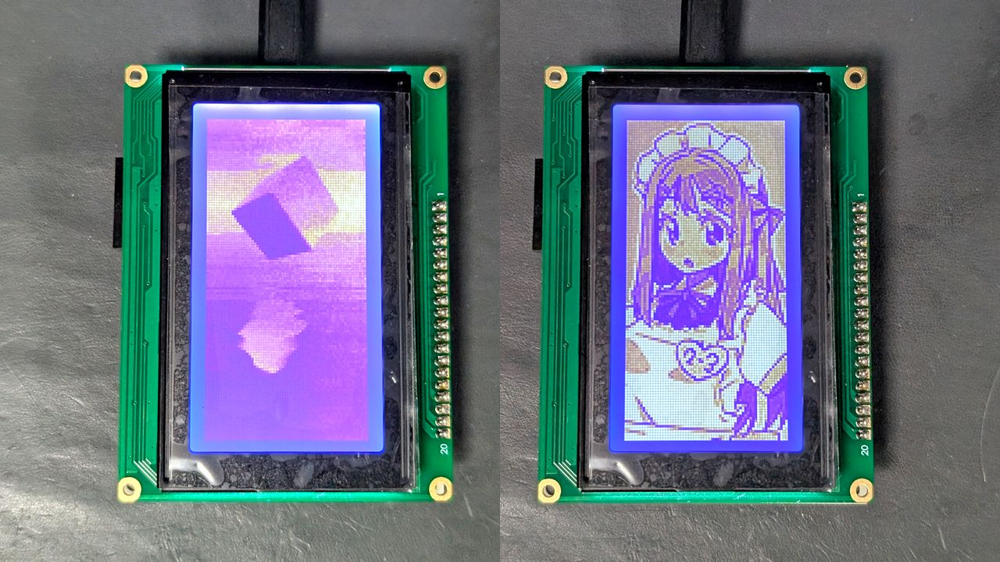

# pdmfrc

Temporal Dithering Using Pulse Density Modulation

[English](README.md)



pdmfrc は、モノクロ液晶で中間調や擬似カラーを表示するライブラリです。

🎥 動画: https://x.com/shapoco/status/2121240088273428980

- 各画素を 1 次 ΔΣ 変調 (PDM) で高速に点滅させます。液晶の応答は遅いので、目には平均が見えます。
- STN 液晶では、点灯の割合によって色も変わります。そのため、グレーの濃淡だけでなく、ある範囲の色も表示できます。
- GRAY8 / RGB565 の画像を、パレット LUT で画素ごとの階調値 (ON デューティ) に変換します。
- 毎フレーム、LCD にそのまま送れる 1bit のビットマップをパックして出力します。

主な特徴は次のとおりです。

- アーキテクチャに依存せず、動的メモリも使いません。作業領域はすべて、ユーザーが渡す arena から取ります。
- 入力形式は GRAY8・RGB565・バイトスワップ済み RGB565 です。変換と同時に、90° 単位の回転と反転、2x2 縮小ができます。
- 出力は縦 8px パック (KS0108, SSD1306 など) または横 8px パックです。MSB と LSB のどちらを先にするかも選べます。
- 任意の矩形を部分的に push / pop できます。
- C++11 以上で動きます。CMake / PlatformIO / ESP-IDF コンポーネントに対応しています。

LCD への転送はアプリ側で行います。

## 仕組み

```
画像 (RGB565) ──LUT──> 階調値 (0..255) ──毎フレーム PDM──> 1bit ビットマップ ──> LCD
                ▲
     パレット: 階調値 → 見かけの色 (表示器ごとに実測)
```

- **パレット**は 256x1 の画像です。x 番目の画素は、ON デューティ x/255 で点滅させた画素の見かけの色です。表示器の機種ごとに実測します。
- **LUT** は、各 RGB565 色に対して、見かけの色が OKLab で最も近い階調値を引く表です。起動時にパレットから生成するか、事前に生成しておきます。
- `pop()` は一定のフレームレートで呼んでください (TG12864B では 103fps)。フレームの開始時刻が揺らぐと、砂嵐状のノイズになります。

## 使い方

```cpp
#include "pdmfrc/pdmfrc.hpp"
#include "pdmfrc/configs/tg12864b.hpp"

const pdmfrc::LcdModule& lcd = pdmfrc::configs::TG12864B;
alignas(4) uint8_t arena[128 * 64 * 2 + 8192];  // pdmfrc::calcRequiredArenaSize(lcd.config)
pdmfrc::Pdm pdm;

void setup() {
  pdm.init(lcd.config, arena, sizeof(arena));
  pdm.initLut(lcd.palette);  // または tools/mklut.py で作った表を pdm.setLut() で使う
}

// 画像が変わったとき (バイトスワップ済み RGB565, 128x64)
void draw(const uint16_t* framebuffer) {
  pdm.push(framebuffer, pdmfrc::PUSH_FLAG_USE_LUT);
}

// 毎フレーム (lcd.fpsQ8 / 256 Hz)
void frame() {
  uint8_t bits[128 * 64 / 8];  // [page][x], LSB が上
  pdm.pop(bits);
  sendToLcd(bits);
}
```

- `push()` と `pop()` は別のコアから呼んでも構いません。
- `push()` は `pop()` の直後に呼んでください。次のフレームの開始が遅れないようにするためです。

次の例は、表示器を反時計回りに 90° 回して縦置きにし、128x256 のフレームバッファを 2x2 平均して表示する場合です。

```cpp
pdm.push(fb, pdmfrc::PUSH_FLAG_SWAP_XY | pdmfrc::PUSH_FLAG_X_FLIP |
                 pdmfrc::PUSH_FLAG_DOUBLE | pdmfrc::PUSH_FLAG_USE_LUT);
```

API の詳細は [SPEC.md](SPEC.md) を参照してください。

## 組み込み方

**CMake**

```cmake
add_subdirectory(path/to/pdmfrc pdmfrc)
target_link_libraries(your_app pdmfrc)
```

オプション (キャッシュ変数):

| 変数 | 既定 | 意味 |
|---|---|---|
| `PDMFRC_POS_8BIT` | OFF | 座標を 8bit にする |
| `PDMFRC_FORMAT_GRAY8` | 1 | この入力形式を組み込む (0 にすると外せる) |
| `PDMFRC_FORMAT_RGB565` | 1 | 同上 (RGB565) |
| `PDMFRC_FORMAT_RGB565_SWAPPED` | 1 | 同上 (バイトスワップ済み RGB565) |
| `PDMFRC_LUT565_{R,G,B}_BITS` | 4, 5, 4 | RGB565 LUT のインデックスのビット数 (8KB) |
| `PDMFRC_HOT_ATTR` | 空 | 内部ループに付ける属性 (RAM 配置のセクションなど) |

**PlatformIO**: `lib_deps` にリポジトリを追加してください。

**ESP-IDF**: リポジトリをコンポーネントとして追加してください。オプションは `idf.py menuconfig` の「pdmfrc」にあります。

## ほかの表示器に対応させる

1. 表示器で gradient サンプル (左から右へ階調値 0..255) を、一定のフレームレートで表示します。
2. 画面を撮影し、見かけの色を 256x1 px のパレット画像にします。
3. `tools/pal2cpp.py` でパレット画像をヘッダに変換します。
4. [include/pdmfrc/configs/tg12864b.hpp](include/pdmfrc/configs/tg12864b.hpp) にならって `LcdModule` を定義します。

## サンプル

| サンプル | 内容 |
|---|---|
| [gradient](examples/core/gradient) | 階調値 0..255 のグラデーション (パレット作成用) |
| [image](examples/core/image) | パレット LUT を通した静止画 |
| [gfx3d](examples/core/gfx3d) | 波打つ水面に浮かぶ金属キューブのリアルタイム 3D ([ShapoGFX](https://github.com/shapoco/shapo-gfx) が必要) |

- `examples/core/` には、アーキテクチャに依存しない部分を置いています。
- `examples/rp2/` には、Raspberry Pi Pico (RP2040) / Pico 2 (RP2350) と TG12864B の組み合わせ向けのビルド環境を置いています。

```sh
export PICO_SDK_PATH=...
export SHAPOGFX_PATH=...   # gfx3d のみ
examples/rp2/image/build.sh          # RP2040
examples/rp2/image/build.sh pico2    # RP2350
```

## ツール

Python 3、Pillow、NumPy が必要です。

| スクリプト | 用途 |
|---|---|
| `tools/pal2cpp.py` | パレット画像 → C++ ヘッダ (RGB888) |
| `tools/mklut.py` | パレット画像 → 生成済み LUT のヘッダ (`Pdm::setLut()` 用) |
| `tools/img2cpp.py` | 画像 → GRAY8 / RGB565 / RGB565_SWAPPED のヘッダ |
| `tools/preview.py` | 表示器での見かけの色を予測する |

## ライセンス

[MIT](LICENSE)
