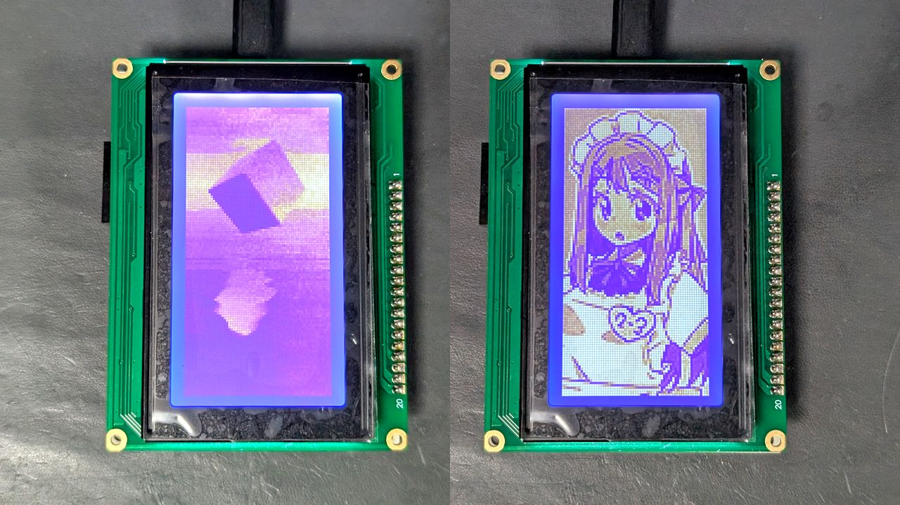
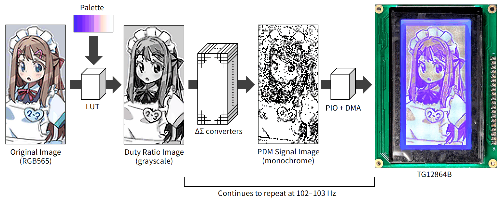

# PDM-FRC

Temporal Dithering Using Pulse Density Modulation

[日本語](README.ja.md)



PDM-FRC shows intermediate tones and pseudo colors on a monochrome LCD. It
blinks each pixel quickly with first-order delta-sigma modulation (PDM). The
liquid crystal responds slowly, so the eye sees the average. On an STN panel
this average is not only a shade of gray: the panel's color shifts with the
duty, so the screen can also show a range of colors.

- 🎥 TG12864B: https://x.com/shapoco/status/2121829393253507565
- 🎥 SG12864ASLB: https://x.com/shapoco/status/2123339579411599804
- 🎥 Nokia 5110: https://x.com/shapoco/status/2123399128889819197
- 🎥 AQM1248A: https://x.com/shapoco/status/2121942341623664857

The library converts GRAY8 / RGB565 images into a level (ON duty) per pixel
through a palette LUT. Each frame, it outputs a packed 1-bit bitmap ready to
send to the LCD.

- No platform dependencies, no dynamic memory: all working memory comes from an arena you provide
- Input: GRAY8, RGB565, RGB565 byte-swapped; rotations and flips (90° steps) and 2x2 downsampling while converting
- Output: 8 vertical pixels per byte (KS0108, SSD1306, ...) or 8 horizontal pixels per byte, MSB or LSB first
- Partial updates: push and pop any rectangle
- C++11, CMake / PlatformIO / ESP-IDF component

Sending the bitmap to the LCD is up to your application.

See also: [モノクロ液晶 TG12864B で色つき階調表示](https://blog.shapoco.net/2026/1116-grayscale-on-tg12864b/)

## How it works



- The *palette* is a 256x1 image: pixel x is the color that a pixel blinking at
  the ON duty x/255 appears to have. It is measured for each display model.
- The *LUT* maps each RGB565 color to the level whose apparent color is nearest
  in OKLab. It is built from the palette at startup, or built offline.
- `pop()` must be called at a steady frame rate (103 fps for the TG12864B). Jitter
  in the frame timing appears as sand-like noise.

## Usage

```cpp
#include "pdmfrc/pdmfrc.hpp"
#include "pdmfrc/configs/tg12864b.hpp"

const pdmfrc::LcdModule& lcd = pdmfrc::configs::TG12864B;
alignas(4) uint8_t arena[128 * 64 * 2 + 8192];  // pdmfrc::calcRequiredArenaSize(lcd.config)
pdmfrc::Pdm pdm;

void setup() {
  pdm.init(lcd.config, arena, sizeof(arena));
  pdm.initLut(lcd.palette);  // or pdm.setLut() with a table from tools/mklut.py
}

// Whenever the image changes (RGB565 byte-swapped, 128x64)
void draw(const uint16_t* framebuffer) {
  pdm.push(framebuffer, pdmfrc::PUSH_FLAG_USE_LUT);
}

// Every frame, at lcd.fpsQ8 / 256 Hz
void frame() {
  uint8_t bits[128 * 64 / 8];  // [page][x], LSB at the top
  pdm.pop(bits);
  sendToLcd(bits);
}
```

`push()` and `pop()` may run on different cores. Run `push()` right after
`pop()`, so that it never delays the next frame.

A display mounted in portrait orientation, turned 90° counterclockwise, with a
128x256 framebuffer averaged 2x2:

```cpp
pdm.push(fb, pdmfrc::PUSH_FLAG_SWAP_XY | pdmfrc::PUSH_FLAG_X_FLIP |
                 pdmfrc::PUSH_FLAG_DOUBLE | pdmfrc::PUSH_FLAG_USE_LUT);
```

See [SPEC.md](SPEC.md) (Japanese) for the full API.

## Integration

**CMake**

```cmake
add_subdirectory(path/to/pdmfrc pdmfrc)
target_link_libraries(your_app pdmfrc)
```

Options (cache variables):

| Variable | Default | Meaning |
|---|---|---|
| `PDMFRC_POS_8BIT` | OFF | 8-bit coordinates |
| `PDMFRC_FORMAT_GRAY8` | 1 | Compile in this input format; set to 0 to drop it |
| `PDMFRC_FORMAT_RGB565` | 1 | Same, for RGB565 |
| `PDMFRC_FORMAT_RGB565_SWAPPED` | 1 | Same, for byte-swapped RGB565 |
| `PDMFRC_LUT565_{R,G,B}_BITS` | 4, 5, 4 | Index bits of the RGB565 LUT (8 KB) |
| `PDMFRC_HOT_ATTR` | (empty) | Attribute of the inner loops, e.g. a RAM section |

**PlatformIO**: add the repository to `lib_deps`.

**ESP-IDF**: use the repository as a component. The options are in `idf.py menuconfig` under "PDM-FRC".

## Supporting another display

Recommended settings are included for `configs::TG12864B` (128x64, KS0108
compatible, blue negative), `configs::SG12864ASLB` (128x64, KS0108 compatible,
positive, grayscale), `configs::AQM1248A` (128x48, ST7565R) and
`configs::NOKIA5110` (84x48, PCD8544, grayscale).

1. Run the gradient example (levels 0..255 from left to right) on the display, at a fixed frame rate.
2. Photograph the screen and make a 256x1 px palette image of the apparent colors.
3. If the lightness goes back somewhere (unevenness of the photograph), fix it with `tools/palfix.py` (`--smooth` averages out a periodic pattern of the photograph, `--normalize` stretches the lightness so that the ends of the palette become black and white). Convert the image into a header with `tools/pal2cpp.py`, and define an `LcdModule` like [include/pdmfrc/configs/tg12864b.hpp](include/pdmfrc/configs/tg12864b.hpp).

### Anti-ghost

Some displays, like the AQM1248A, darken a whole column (or row) that has many
dark pixels. With `CFG_FLAG_ANTIGHOST_COL` (columns) or
`CFG_FLAG_ANTIGHOST_ROW` (rows) in `Config::flags`, pop subtracts an amount
proportional to the sum of the levels of each column (row) from its levels.
Set the strength and the gamma with `setAntiGhost()` (`LcdModule::antiGhost`
and `antiGhostGammaQ8` are the recommended values), tuning them with the
pattern of the gradient example. A gamma below 1 weights the middle levels
more in the sum.

## Examples

| Example | Description |
|---|---|
| [gradient](examples/core/gradient) | Gradient of levels 0..255, for making a palette |
| [image](examples/core/image) | A still image through the palette LUT |
| [gfx3d](examples/core/gfx3d) | Real-time 3D: a metal cube over wavy water (requires [ShapoGFX](https://github.com/shapoco/shapo-gfx)) |

`examples/core/` holds the platform-independent parts. See
[examples/rp2/README.md](examples/rp2/README.md) for the Raspberry Pi Pico
(RP2040 / RP2350) builds and wiring details.

Prebuilt binaries (`.uf2`) of the RP2 examples can be downloaded from the
[Releases](https://github.com/shapoco/pdmfrc/releases) page.

## Tools

The tools need Python 3, Pillow and NumPy.

| Script | Purpose |
|---|---|
| `tools/pal2cpp.py` | Palette image → C++ header (RGB888) |
| `tools/palfix.py` | Makes the lightness of a palette image monotonic, filling the dips with straight lines |
| `tools/mklut.py` | Palette image → prebuilt LUT header, for `Pdm::setLut()` |
| `tools/img2cpp.py` | Image → GRAY8 / RGB565 / RGB565_SWAPPED header |
| `tools/preview.py` | Predicts the apparent colors of an image on the display |

## License

[MIT](LICENSE)
