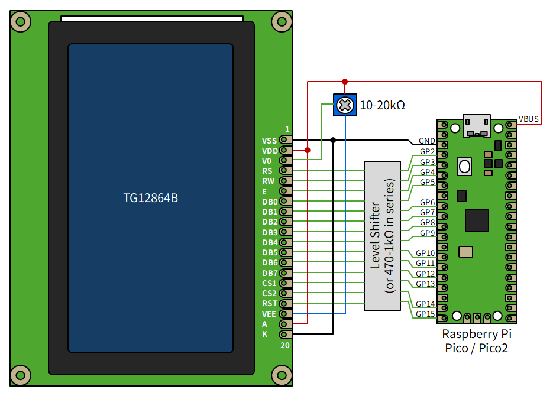

# PDM-FRC サンプル (RP2040 / RP2350)

[English](README.md)

Raspberry Pi Pico (RP2040) または Pico 2 (RP2350) で液晶を駆動するサンプルです。アプリケーション側のコードは [`examples/core/`](../core) にあります。

ディスプレイはビルド時に選びます ([ビルド](#ビルド) を参照)。

| ディスプレイ | `PDMFRC_DISPLAY` | 備考 |
|---|---|---|
| TG12864B (128x64、KS0108 互換) | `tg12864b` (既定) | |

| ディレクトリ | 内容 | システムクロック | ディスプレイ |
|---|---|---|---|
| [gradient](gradient) | 階調値 0..255 のグラデーション (パレット作成用) | 125 MHz | すべて |
| [image](image) | パレット LUT を通した静止画 | 125 MHz | TG12864B |
| [gfx3d](gfx3d) | 波打つ水面に浮かぶ金属キューブのリアルタイム 3D ([ShapoGFX](https://github.com/shapoco/shapo-gfx) が必要) | 250 MHz | TG12864B |

LCD への書き込みは PIO + DMA で行います。`Pdm::pop()` が出力したビットマップを、毎フレーム一定のレートで送ります。TG12864B では 103 fps です。

## 接続 (TG12864B)



| Pico | TG12864B | 備考 |
|---|---|---|
| GPIO2 | D/I (RS) | |
| GPIO3 | R/W | PIO が駆動するのは Busy 待ちモードのときだけです。固定サイクルモードでは Low 固定です。 |
| GPIO4 | E | |
| GPIO5 | DB0 | |
| GPIO6 | DB1 | |
| GPIO7 | DB2 | |
| GPIO8 | DB3 | |
| GPIO9 | DB4 | |
| GPIO10 | DB5 | |
| GPIO11 | DB6 | |
| GPIO12 | DB7 | Busy フラグの読み取りにも使います。 |
| GPIO13 | CS1 | 左半分 (x = 0..63)、アクティブ High |
| GPIO14 | CS2 | 右半分 (x = 64..127)、アクティブ High |
| GPIO15 | /RST | アクティブ Low |
| GND | VSS | |

- PIO は GPIO2..14 を連続した 1 ブロックとして使います。そのため、ピンを 1 本ずつ入れ替えることはできません。変更する場合は、[common/tg12864b.cpp](common/tg12864b.cpp) の `PIN_*` と [common/tg12864b.hpp](common/tg12864b.hpp) のビット配置 (`BIT_*`) を合わせて書き換えてください。
- VDD、コントラスト電圧 (VO / VEE)、バックライトは、LCD モジュールのデータシートに従って供給してください。
- モジュールのロジック電圧を確認してください。既定の Busy 待ちモードでは、ステータス読み出しの間 LCD が DB0..DB7 を駆動します。5 V で動くモジュールの場合は、レベルシフタを入れてください。または、固定サイクルモード (`w` キー) に切り替え、R/W を GND に固定してください。

## ビルド済みバイナリ

ビルド済みバイナリは [Releases](https://github.com/shapoco/pdmfrc/releases) ページからダウンロードできます。zip ファイルの中の `rp2/<サンプル名>/<board>/<サンプル名>.uf2` が書き込むファイルです (`pico`: RP2040、`pico2`: RP2350)。BOOTSEL ボタンを押しながら Pico を接続し、現れたドライブに `.uf2` をコピーしてください。

## ビルド

必要なもの: [Pico SDK](https://github.com/raspberrypi/pico-sdk) (RP2350 には 2.x が必要)、CMake、Ninja、Arm GNU ツールチェイン

```sh
export PICO_SDK_PATH=/path/to/pico-sdk
export SHAPOGFX_PATH=/path/to/shapo-gfx   # gfx3d のみ (v1.12.0 以降)

examples/rp2/image/build.sh            # Pico (RP2040)
examples/rp2/image/build.sh pico2      # Pico 2 (RP2350)
```

`build.sh [board] [display] [options...]` は次のコマンドを実行します。ディスプレイの既定は `tg12864b` です。それより後の引数は CMake に渡されます。

```sh
cmake -S . -B build/<board>-<display> -G Ninja -DCMAKE_BUILD_TYPE=Release -DPICO_BOARD=<board> -DPDMFRC_DISPLAY=<display> [options...]
ninja -C build/<board>-<display>
```

各サンプルのディレクトリに `build/<board>-<display>/<サンプル名>.uf2` ができます。BOOTSEL ボタンを押しながら Pico を接続し、現れたドライブに `.uf2` をコピーしてください。

システムクロックは次のように変更できます。133 MHz を超える場合は、コア電圧を 1.20 V に上げます。

```sh
examples/rp2/gfx3d/build.sh pico2 -DSYS_CLOCK_KHZ=200000
```

## シリアルコマンド

サンプルは USB CDC (USB 経由の stdio) で通信します。端末ソフトでシリアルポートを開き、`h` を押すとヘルプが表示されます。

| キー | 動作 |
|---|---|
| `f` / `F` | フレームレートのプリセットを下げる / 上げる |
| `[` / `]` | フレームレート -1 / +1 fps |
| `r` | 位相モードを切り替えて、位相をリセットする |
| `R` | 位相をリセットする |
| `s` | ステータスを表示する (統計もリセットする) |
| `h` / `?` | ヘルプ |

ディスプレイ固有のキー:

| ディスプレイ | キー | 動作 |
|---|---|---|
| TG12864B | `b` / `B` | バスサイクルを短く / 長くする |
| TG12864B | `w` | Busy 待ち / 固定サイクルを切り替える |

サンプル固有のキー:

| サンプル | キー | 動作 |
|---|---|---|
| image | `g` | LUT 変換 / グレー変換を切り替える |
| gfx3d | `y` | フレーム同期のオン / オフ |
| gfx3d | `o` | 回転 (0 / ccw90 / 180 / cw90) |
| gfx3d | `z` | 縮小 1/2 / 等倍を切り替える |
| gfx3d | `p` | アニメーションを一時停止する |
