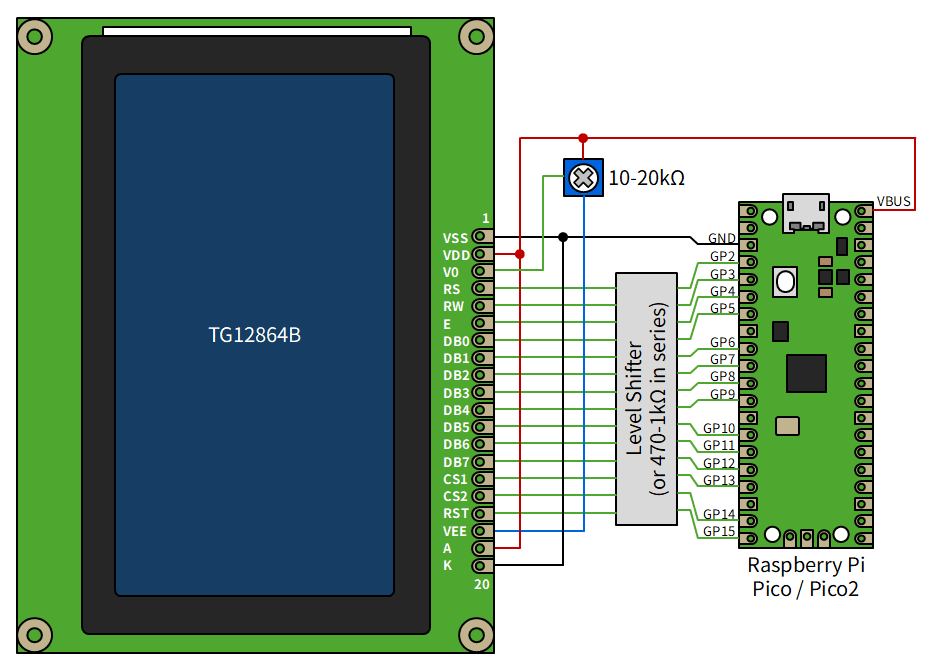

# PDM-FRC examples for RP2040 / RP2350

[日本語](README.ja.md)

These examples drive an LCD from a Raspberry Pi Pico (RP2040) or Pico 2
(RP2350). The application-side code is in [`examples/core/`](../core).

The display is chosen at build time (see [Build](#build)):

| Display | `PDMFRC_DISPLAY` | Notes |
|---|---|---|
| TG12864B (128x64, KS0108 compatible) | `tg12864b` (default) | |
| SG12864ASLB (128x64, KS0108 compatible) | `sg12864aslb` | Same wiring and driver as the TG12864B, 73 fps |
| AQM1248A (128x48, ST7565R) | `aqm1248a` | gfx3d is cropped to 48x128 |
| Nokia 5110 (84x48, PCD8544) | `nokia5110` | Same wiring as the AQM1248A, 79 fps. gfx3d is cropped to 48x84 |

| Directory | Contents | System clock | Displays |
|---|---|---|---|
| [gradient](gradient) | Gradient of levels 0..255, for making a palette | 125 MHz | all |
| [image](image) | A still image through the palette LUT (`assets/images/<display>.png`) | 125 MHz | all |
| [gfx3d](gfx3d) | Real-time 3D: a metal cube over wavy water (requires [ShapoGFX](https://github.com/shapoco/shapo-gfx)) | 250 MHz | all |

The LCD is written by PIO + DMA. Every frame, the bitmap from `Pdm::pop()` is
sent at a fixed rate (103 fps for the TG12864B, 73 fps for the SG12864ASLB).

## Wiring (TG12864B, SG12864ASLB)



| Pico | TG12864B | Notes |
|---|---|---|
| GPIO2 | D/I (RS) | |
| GPIO3 | R/W | Driven by PIO only in busy wait mode; held Low in fixed cycle mode |
| GPIO4 | E | |
| GPIO5 | DB0 | |
| GPIO6 | DB1 | |
| GPIO7 | DB2 | |
| GPIO8 | DB3 | |
| GPIO9 | DB4 | |
| GPIO10 | DB5 | |
| GPIO11 | DB6 | |
| GPIO12 | DB7 | Also read as the busy flag |
| GPIO13 | CS1 | Left half (x = 0..63), active High |
| GPIO14 | CS2 | Right half (x = 64..127), active High |
| GPIO15 | /RST | Active Low |
| GND | VSS | |

- The PIO uses GPIO2..14 as one contiguous block, so these pins cannot be moved
  one by one. To change them, edit `PIN_*` in
  [common/tg12864b.cpp](common/tg12864b.cpp) and the bit layout (`BIT_*`) in
  [common/tg12864b.hpp](common/tg12864b.hpp) together.
- Supply VDD, the contrast voltage (VO / VEE) and the backlight as given in the
  LCD module's datasheet.
- Check the logic level of your module. In busy wait mode (the default), the
  LCD drives DB0..DB7 during status reads. If the module runs at 5 V, use a
  level shifter, or switch to fixed cycle mode (`w` key) and tie R/W to GND.

## Wiring (AQM1248A)

| Pico | AQM1248A | Notes |
|---|---|---|
| GPIO16 | RST | Active Low |
| GPIO17 | CS | Active Low |
| GPIO18 | SCK | |
| GPIO19 | SDI | |
| GPIO20 | RS | |
| 3V3 (OUT) | VDD | 3.0 V typ, 3.6 V max |
| GND | GND | |

- The LCD scans by its own oscillator (about 128..179 Hz by the datasheet). It
  cannot be adjusted nor synchronized, so find the frame rate with the least
  noise by eye (`[` / `]`, `{` / `}`).
- Many dark pixels in a column (the short side, 48 px) darken the whole
  column. The anti-ghost of the columns cancels it, with strength 107 and
  gamma 0.45 at start (the palette was made with them). To tune them, show
  the tuning pattern of the gradient example (`t`) and change the strength
  (`a` / `A`) and the gamma (`e` / `E`) until the area below the black block
  looks the same as the rest. The background levels near both ends
  (`l` / `L`) hide the difference: tune the strength at a background of about
  40..64 and the gamma at about 128, and repeat. The palette depends on them.

## Wiring (Nokia 5110)

| Pico | Nokia 5110 | Notes |
|---|---|---|
| GPIO16 | RST | Active Low |
| GPIO17 | CE | Active Low |
| GPIO18 | CLK | 4 MHz max |
| GPIO19 | DIN | |
| GPIO20 | DC | |
| 3V3 (OUT) | VCC | |
| GND | GND | |
| (open) | LIGHT | Backlight, depends on the module (not needed) |

- The LCD scans by its own oscillator and cannot be synchronized: 79 fps
  looked best. Find the frame rate with the least noise by eye if needed
  (`[` / `]`, `{` / `}`).
- The contrast (Vop, `k` / `K`) differs from module to module: the palette was
  made with Vop 64 and the bias system (`x` / `X`) 1/48.

## Prebuilt binaries

Prebuilt binaries can be downloaded from the
[Releases](https://github.com/shapoco/pdmfrc/releases) page. The zip file
holds `rp2/<display>/<example>/<board>/<example>.uf2` (`pico`: RP2040, `pico2`: RP2350).
Hold BOOTSEL while connecting the Pico, then copy the `.uf2` to the drive that
appears.

## Build

Requirements: [Pico SDK](https://github.com/raspberrypi/pico-sdk) (2.x for
RP2350), CMake, Ninja and the Arm GNU toolchain.

```sh
export PICO_SDK_PATH=/path/to/pico-sdk
export SHAPOGFX_PATH=/path/to/shapo-gfx   # gfx3d only (v1.12.0 or later)

examples/rp2/image/build.sh            # Pico (RP2040)
examples/rp2/image/build.sh pico2      # Pico 2 (RP2350)
examples/rp2/image/build.sh pico sg12864aslb   # SG12864ASLB
examples/rp2/gradient/build.sh pico aqm1248a   # AQM1248A
```

`build.sh [board] [display] [options...]` runs the following. The display is
`tg12864b` by default. The arguments after them are passed to CMake:

```sh
cmake -S . -B build/<board>-<display> -G Ninja -DCMAKE_BUILD_TYPE=Release -DPICO_BOARD=<board> -DPDMFRC_DISPLAY=<display> [options...]
ninja -C build/<board>-<display>
```

The output is `build/<board>-<display>/<example>.uf2` in each example's directory. Hold
BOOTSEL while connecting the Pico, then copy the `.uf2` to the drive that
appears.

To change the system clock (above 133 MHz the core voltage is raised to 1.20 V):

```sh
examples/rp2/gfx3d/build.sh pico2 -DSYS_CLOCK_KHZ=200000
```

## Serial commands

The examples talk over USB CDC (stdio over USB). Open the serial port with a
terminal and press `h` for help.

| Key | Action |
|---|---|
| `f` / `F` | Frame rate preset down / up |
| `[` / `]` | Frame rate -1 / +1 fps |
| `{` / `}` | Frame rate -0.1 / +0.1 fps |
| `a` / `A` | Anti-ghost strength -1 / +1 (displays with the anti-ghost only: AQM1248A) |
| `e` / `E` | Anti-ghost gamma -0.05 / +0.05 (same as above) |
| `r` | Next phase mode, then reset the phase |
| `R` | Reset the phase |
| `s` | Status (and reset the statistics) |
| `h` / `?` | Help |

Keys of each display:

| Display | Key | Action |
|---|---|---|
| TG12864B, SG12864ASLB | `b` / `B` | Bus cycle shorter / longer |
| TG12864B, SG12864ASLB | `w` | Busy wait / fixed cycle |
| AQM1248A | `c` / `C` | SCLK down / up (1..20 MHz) |
| AQM1248A | `k` / `K` | Contrast (electronic volume) -1 / +1 |
| AQM1248A | `x` / `X` | V0 regulator resistor ratio -1 / +1 |
| AQM1248A | `u` | Rotate 180 degrees |
| Nokia 5110 | `c` / `C` | SCLK down / up (0.5..4 MHz) |
| Nokia 5110 | `k` / `K` | Vop (contrast) -1 / +1 |
| Nokia 5110 | `x` / `X` | Bias system -1 / +1 |

Keys of each example:

| Example | Key | Action |
|---|---|---|
| gradient | `t` | Gradient / anti-ghost tuning pattern |
| gradient | `l` / `L` | Background level of the tuning pattern -4 / +4 |
| image | `g` | LUT / gray conversion |
| gfx3d | `y` | Frame sync on / off |
| gfx3d | `o` | Rotation (0 / ccw90 / 180 / cw90) |
| gfx3d | `z` | Scale 1/2 / 1/1 |
| gfx3d | `p` | Pause the animation |
